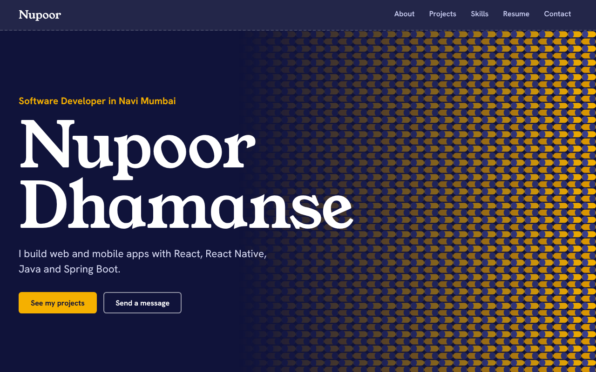
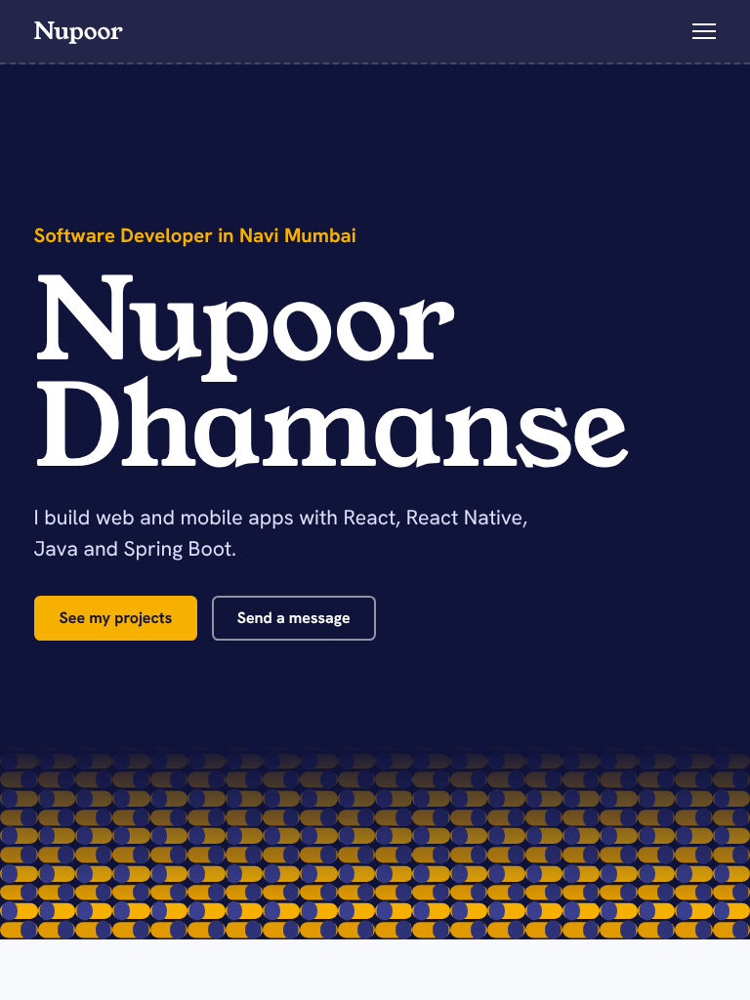
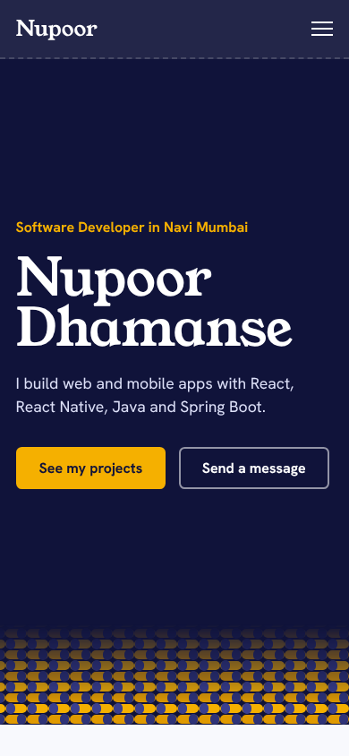

# Portfolio Website

A responsive, performance-focused personal portfolio built with **React 18 + Vite**.

**Live site:** https://nupoor-portfolio.netlify.app/
**Repository:**https://github.com/Nupoor1611/portfolio

## Sections

About Me · Projects · Skills · Resume · Contact (with validated form)

## Customise

All content lives in [`src/data.js`](src/data.js): bio, experience, education, projects, skills and certifications. To finish it, add your `github` and `linkedin` URLs (hidden until set), add `live` and `code` links to projects, and swap the illustrations in `public/projects/` for real screenshots. The site does not include or link to a resume PDF; the Resume section is built from the data file.

## Run locally

```bash
npm install
npm run dev       # development server
npm run build     # production build -> dist/
npm run preview   # serve the production build at http://127.0.0.1:4173
```

Requires Node 18+.

## Development process

1. **Scaffold** — Vite + React; components per section (`src/components`), content separated into `src/data.js`.
2. **Visual design** — the look comes from woven, indigo-dyed cloth, a nod to the Vastraa clothing-store project. Deep indigo, one marigold accent, Young Serif for headings and Hanken Grotesk for text (both self-hosted through Fontsource, so there are no third-party font requests). A woven pattern draws itself across the hero once on load, and dashed "stitch" lines divide content instead of card shadows. Projects use one large feature plus a list rather than identical cards.
3. **Responsive design** — mobile-first CSS with fluid type via `clamp()`, `auto-fit` grids, and a full-screen menu at 820px and below. The title and content sit side by side from 896px up. The root font size steps up at 1600px and 2200px, so large monitors do not look tiny. Safe-area insets, 16px form fields (no iOS zoom), `dvh` units and 44px tap targets are covered.
4. **Accessibility** — semantic landmarks, skip link, labelled form fields with `aria-invalid`/`aria-describedby`, visible focus rings, `prefers-reduced-motion` support, alt text and explicit image dimensions.
5. **Resume section** — experience, education and certifications are rendered from data. There is no PDF in the project.

## Performance optimisations

| Technique              | Where                                                                                          |
| ---------------------- | ---------------------------------------------------------------------------------------------- |
| Component lazy loading | `React.lazy` + `Suspense` for About, Projects, Skills, Resume, Contact (separate JS chunks)    |
| Render-on-approach     | `LazySection` uses `IntersectionObserver` (300px margin) so chunks load only near the viewport |
| Image lazy loading     | `loading="lazy"`, `decoding="async"` and fixed `width`/`height` to prevent layout shift        |
| Minification           | Vite production build: esbuild JS minification and CSS minification                            |
| Vendor chunking        | React split into its own long-cache chunk                                                      |
| Self-hosted fonts      | Latin subsets only load for the characters used, `font-display: swap`, no third-party requests |
| Caching                | Hashed filenames + `immutable` cache headers (`netlify.toml`, `vercel.json`)                   |

Production build output (gzip): app JS ≈ 6 kB, React ≈ 45 kB, CSS ≈ 6 kB, each section chunk ≈ 0.3–1 kB, plus two small font files.

## Verification performed

- `npm run build` succeeds, and `vite preview` serves the pages, assets, fonts and images.
- Automated Playwright checks in Chromium at 14 screen sizes, from 320×568 to 2560×1440. They include 430×932, 768×1024 and 820×1180, a phone in landscape (844×390), and the exact 820/821px menu breakpoint. At every size: no horizontal scrolling, all fonts and images load, no console errors, tap targets of 40px or more, working form validation, and every jump link (hero button and all five nav links) lands on its section. At 820px and below, the mobile menu opens and closes with the Escape key.
- **Still to do by you:** Firefox and Safari checks and a test on a real phone (see the checklist below). The test environment only had Chromium.

## Deployment

Pick one.

### Netlify (recommended)

1. Push this repo to GitHub.
2. Netlify → _Add new site_ → _Import from Git_ → choose the repo. Build settings are read from `netlify.toml` (`npm run build`, publish `dist`).
3. **Custom domain:** _Domain management → Add a domain_, then either point your registrar's nameservers to Netlify or add the DNS records Netlify shows (A/ALIAS for apex, CNAME for `www`).
4. **SSL:** _Domain management → HTTPS → Verify DNS / Provision certificate_ (free Let's Encrypt, auto-renews). Enable _Force HTTPS_.

### Vercel

1. _Add New → Project_ → import the repo; framework preset **Vite** (config in `vercel.json`).
2. _Settings → Domains_ → add your domain and create the DNS record Vercel shows. SSL is issued automatically.

### GitHub Pages

1. Repo → _Settings → Pages → Source: GitHub Actions_.
2. Push to `main`; `.github/workflows/deploy.yml` builds with `VITE_BASE=/<repo>/` and deploys.
3. _Custom domain_ in Pages settings, then tick _Enforce HTTPS_.

## Post-deploy test checklist

- [ ] Site loads over HTTPS with a valid certificate; `http://` redirects to `https://`
- [ ] Every nav link scrolls to its section; mobile menu opens/closes
- [ ] Contact form shows errors for invalid input and opens the mail client for valid input
- [ ] Chrome, Firefox, Safari, Edge (latest) — and Safari on iOS / Chrome on Android
- [ ] Responsive: 360px, 768px, 1024px, 1440px (browser dev tools device mode, plus a real phone)
- [ ] Lighthouse (Chrome DevTools) ≥ 90 for Performance, Accessibility, Best Practices, SEO

## Challenges and solutions

- **Jump links vs. lazy sections.** Sections load as you scroll to them, and they are taller than their placeholders. Clicking "Contact" from the top therefore scrolled to where Contact used to be, and the page ended up in the wrong section, which was worst on small phones. Fix: the section `id`s sit on the always-present wrapper, and any jump link first loads every section, waits for the layout to settle, and then scrolls (`useAnchorJumps` in `src/App.jsx`). Opening an address like `/#contact` works the same way. Found by testing real clicks at 14 screen sizes.
- **Mobile menu and `backdrop-filter`.** A `position: fixed` menu inside a header with `backdrop-filter` is positioned against the header, not the screen, so the menu had no height. Fix: the menu is absolutely positioned under the header with an explicit `dvh` height.
- **Weave pattern behind text on small screens.** On phones and tablets the pattern ran under the intro text and buttons. It is now a band along the bottom of the hero, and it fills the right side only from 896px up.
- **Contact form without a backend.** A static site can't send mail. The form validates client-side and opens a prefilled `mailto:`; for server-side delivery, swap in Netlify Forms or Formspree.
- **Resume.** The resume is rendered from data so it stays searchable and responsive. The PDF and its download button were removed on request.
- **GitHub Pages sub-path.** Project sites are served from `/<repo>/`, so Vite's `base` is configurable through the `VITE_BASE` env var.

## Screenshots

| Desktop (1280px)                  | Tablet (768px)                  | Phone (390px)                  |
| --------------------------------- | ------------------------------- | ------------------------------ |
|  |  |  |

Full-page captures: [`docs/desktop-full.png`](docs/desktop-full.png), [`docs/mobile-full.png`](docs/mobile-full.png).
The project images are illustrations, not real screenshots. Replace them with real ones when you have them.
